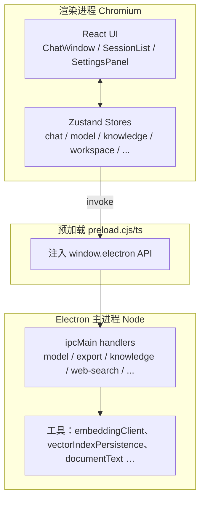
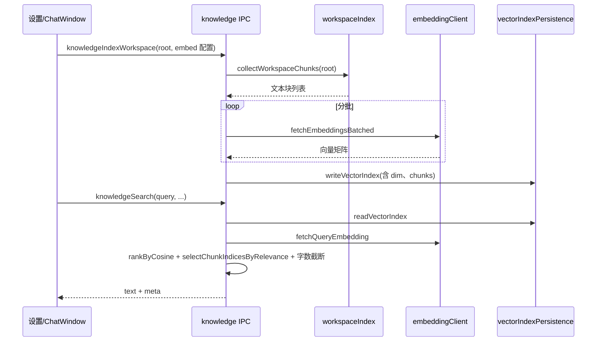

# MyAgent 架构设计说明

## 1. 设计目标与约束

- **本地优先**：对话与偏好默认驻留客户端；模型推理可发生在用户自管的云端 API 或本地 Ollama，由用户配置。
- **职责分离**：渲染进程负责交互与即时状态；主进程承载文件访问、HTTPS 出站、以及与操作系统相关能力（快捷键、托盘等，以实现对齐）。
- **可替换供应商**：文本模型、嵌入向量、网页搜索均采用可插拔的「提供商 + endpoint + model」模型。

## 2. 逻辑分层

### 2.1 展示层（`src/`）

- **组件**：会话列表 `SessionList`、对话主区 `ChatWindow`、气泡 `MessageItem`、Markdown 渲染 `MarkdownContent`、设置 `SettingsPanel`、引导 `OnboardingSteps`。
- **状态**：会话 `chatStore`、模型列表 `modelStore`、服务连接 `connectionStore`、知识与嵌入 `knowledgeStore`、工作区 `workspaceStore`、联网 `webSearchStore`、全局设置 `settingStore`。旧版项目 / 记忆 / 工作流存储已退役，磁盘上的旧文件仅保留供备份。
- **模型设置中心**（`src/features/modelHub/ModelSettingsHub.tsx`）分四页：
  - 「快速配置」：`QuickSetup` + `vendorCatalog`。选厂商、填密钥后，通过 `discoverServiceModels` 读取模型并按名称分类，再由 `quickSetupApply` 创建一个服务连接，挂上对话 / 生图 / 视频模型和向量配置，最后用 `diagnoseModel` 测试对话链路。
  - 「对话与图片」。
  - 「全局能力」：语音、视频、向量检索、联网搜索。向量检索可通过 `knowledgeStore.embeddingConnectionId` 复用服务连接的地址和密钥。
  - 「服务连接」。
  - 协议、上下文容量等专业选项统一收在「高级设置」。
- **国际化**：文案聚合于 `src/i18n/ui.ts`，通过 `useI18n()` 取用。

### 2.2 预加载与会话边界

- `preload` 暴露白名单 API（`callModel`、`knowledgeSearch`、`persistGet`/`persistSet`、`readWorkspaceHint`、`webSearch` 等），避免渲染进程直接使用任意 Node/Electron 模块（具体以 `preload.cjs` 与类型定义为准）。

### 2.3 主进程（`electron/`）

| 模块 | 职责概要 |
|------|----------|
| `ipc/model`、`ipc/model-stream` | HTTP(S) 请求大模型，非流式与 SSE 流式；错误归一与用户可见提示 |
| `ipc/export`、`ipc/file`、`ipc/documents` | 工作区枚举、会话导出路径、结构化文档读取与辅助导出 |
| `ipc/web-search` | 封装各搜索后端 |
| `ipc/knowledge` + `utils/workspaceIndex`、`knowledgeIndexOperations`、`vectorIndexPersistence`、`embeddingClient` | 建索引：**全文**或按文件指纹的**增量**（改动文件单独重嵌入、未改向量复用）→向量 JSON 落盘；查询：单次嵌入→余弦相似度→相关度截断 |
| `utils/documentText` | Excel / Word / Markdown 转为模型可读正文 |
| `utils/markdownExport` | 从助手 Markdown 管道表生成 xlsx/docx |
| `document-workbench/` | 文档预览、编辑、版本与恢复；PDF 抽取与离线 OCR；CSV/Excel 真实计算与图表 |
| `workbench-runtime/` | 任务账本与检查点、定时提醒与监控、MCP 连接与调用审批、加密完整备份与升级快照 |
| `ipc/agent-local`、`ipc/agent-web` | 本机文件工具（受授权目录约束）与隔离浏览器工具 |
| `ipc/image-gen`、`ipc/video-gen`、`media-workbench/` | 生图适配器与队列、MiniMax 视频异步任务、媒体版本 |
| `quick-window`、`ipc/remote-gateway` | 独立快捷对话窗口；局域网远端页网关 |

## 3. 关键数据流

### 3.1 发送一条用户消息（简化）

桌面、快捷窗口、远端页与后台任务共用 `src/chat/sendPipeline.ts`：

1. `tryClaimSessionSend` 占用发送权。同一会话同一时刻只允许一次回复或压缩，不同会话可并行：`ChatWindow` 的流式订阅、停止标志与生图进度按会话各存一份（`useSessionStreamRefs` / `useSessionRunUi`），preload 为每条模型流生成 `streamId`，主进程按「窗口 + streamId」路由事件与中止，停止一个会话不影响其他会话。后台任务调度器跳过会话正忙的任务，任务之间仍串行；
2. `ensureContextBeforeSend` 估算上下文，超过约 95% 软上限时摘要较早消息；
3. 落用户消息并写任务检查点；
4. `runModelReply` 决定路径：`shouldEnterAgentReply` 仅在开启对应工具且命中明确意图时进入 Agent。本机文件意图须同时出现文件类对象与查找/阅读类动作，方法提问与指代上文不进入；
5. 普通路径：`buildOutgoingChain` 临时注入工作区知识文件、向量片段与联网结果（不写入聊天记录），`enrichMessagesForModel` 展开附件，经 `subscribeModelStream` 或非流接口发送；
6. Agent 路径：只保留当前用户句，工具结果作为系统消息回填，最多 10 轮。本机 Agent 跳过向量注入，改由 `local_search` 语义模式查询同一索引；
7. 流式增量经 `createAnimStream` 按节拍写入 store。

### 3.2 向量知识库流水线

## 4. 持久化与客户数据

- 会话与用户偏好：**Zustand + 自定义持久化**（`persistSet`/`persistGet`）；每个 store 一个 JSON 文件。会话仓库按对话拆分：`chat-storage.json` 只存索引（`sessionIds` 顺序与当前选中），每个对话一份 `chat-session.<id>.json`；渲染端按会话对象引用只发送变化的对话，主进程依次写会话文件、写索引、清理已删对话，读取时拼回整份结构交给 zustand。旧版整份格式照常可读，首次写入时迁移并保留 `chat-storage.pre-split.json`；单个会话文件损坏时改名为 `chat-corrupt.*` 隔离，不影响其他对话。备份按 `persist/*.json` 逐文件打包，自动覆盖拆分后的文件。`zustandPersistJson` 在桌面端只暂存状态引用，防抖（160 ms）到期或 `beforeunload` 冲刷时才序列化并写盘，流式期间的高频状态更新不会逐次序列化整份会话。含密钥的配置类仓库在主进程逐字段加密。任一仓库文件解析失败时改名为 `.corrupt-<时间戳>.json` 隔离，渲染端暂停该仓库写盘，避免空状态覆盖原数据；会话索引损坏时按现存 `chat-session.*.json` 重建，清理只删除本次读到或写过的会话文件。
- 向量索引：`vector-index-v1.json`（见 `vectorIndexFilePath()`）含 `chunks` 与可选 **`fingerprints`**（相对 POSIX 路径 → `mtime` / 字节规模），用于增量建索引时对未改动文件向量复用；无指纹的旧文件在用户首次触发「增量」时会退化为**全文重建并写入指纹**。聊天历史与该文件分离存放。

## 5. Electron 生命周期与流式收尾

- **单实例**：`app.requestSingleInstanceLock()`，`second-instance` 时唤醒主窗，避免两套进程争用 `userData`。
- **首窗展示**：BrowserWindow `show: false`，`ready-to-show` 后再 `show()`。
- **`render-process-gone`**：在非干净退出时打日志便于分发版排查。
- **流式 preload**：用户对 `subscribeModelStream` 的返回值仅发送 `abort`；须在收到主进程 `model-stream-end`/`error` 后再移除 IPC 监听，否则可能在取消时丢失 UI 侧的 `onEnd` 收口。

## 6. 安全与网络

- 联网与模型调用均在主进程或受控链路发起以便统一超时与密钥不落日志（实现上应避免将完整密钥打印到控制台）。
- 主窗口与快捷窗口 `webPreferences` 为 `contextIsolation: true`、`nodeIntegration: false`，`window.electron` / `window.quickAgent` 经 `contextBridge` 暴露，页面脚本拿不到 `require` 与 `ipcRenderer`。主窗口 `sandbox: false`（preload 需 require 同目录子模块），`webSecurity` 已恢复默认开启，本地文件经 `local-file:` 协议读取。
- preload 的 IPC 参数统一经 JSON 往返清洗，二进制（`ArrayBuffer` / `Uint8Array`，含对象第一层字段）原样走结构化克隆；通用 `send`/`on` 只放行白名单通道。
- 主窗口拦截 `will-navigate`、`setWindowOpenHandler` 与 `will-attach-webview`，外链仅 http/https/mailto 经 `shell.openExternal` 打开；媒体权限只授予应用自身页面。`index.html` 设 CSP（`object-src 'none'`，脚本仅本地来源）。
- Agent 本机路径经 `agentPathScope` 做 realpath 与大小写不敏感比较，内置拒绝 `.ssh`、`.aws`、钥匙串、浏览器配置与应用 `persist`/`runtime`/`logs` 目录及 `/private/etc`；系统临时目录放行。读文件类 IPC 同样拒绝敏感路径，`open-local-file` 拒绝可执行文件。
- 应用启动走 `execFile` + 名称白名单；网页图片抓取做 SSRF 防护并限 20MB；远端网关 `/diag` 脱敏、401 限流，配置文件权限 0600。
- 助手 Markdown 中的链接只允许 http/https/mailto 并新窗口打开，远程图片需点击后才加载。MCP 工具调用需用户审批（`McpApprovalPrompt`），服务端 `readOnlyHint` 仅在工具名不含写入类动词时采信。
- 联网搜索密钥按来源分别保存（`keys.tavily` / `keys.brave`），某一来源失败时只对该来源回退 DuckDuckGo。

## 7. 构建与分发

- **Vite**：打包渲染层；主进程可对 `axios`、`exceljs`、`mammoth` 等拆 **vendor chunk**，降低 `main.js` 解压体积。
- **`vite-plugin-electron`**：联动主进程/预加载；
- **`electron-builder`**：按目标平台产出 DMG/Setup/AppImage；
- CI 可选用 `npm run build` + 各目标 `npm run package:*`。

---

*本文描述与仓库代码一致；迭代后请同步更新需求清单与设计文档章节。*
